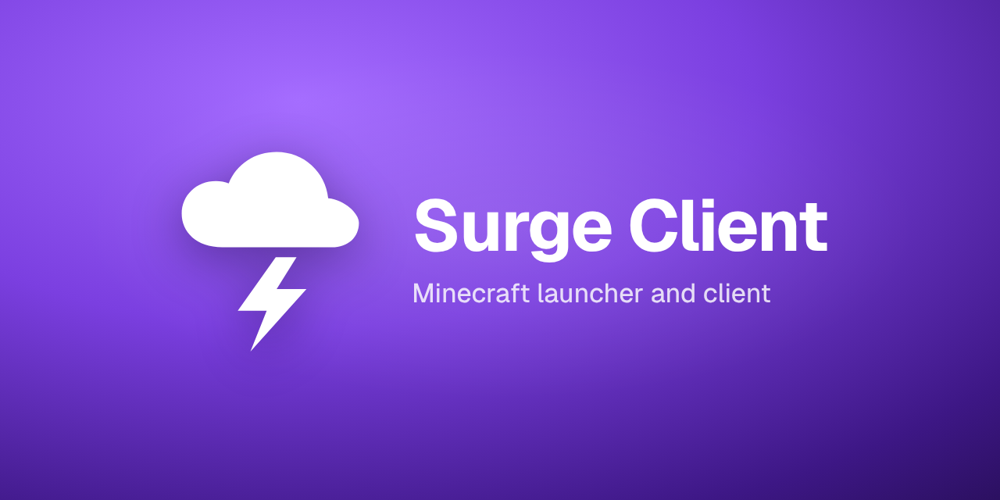

# Surge Client

A Minecraft launcher and client for **Minecraft 1.21.11** (Fabric), made to be fast and easy to use.

## Download

Get **Surge-Client-…-Standalone.exe** from the [latest release](../../releases/latest) and run it. No installation needed.
The launcher and the in-game mod keep themselves up to date.

Requires Windows 10 or 11 and a Minecraft Java Edition account.

## What's inside

**Launcher**
- Modpacks: create, edit, import, and browse Modrinth and CurseForge mods, modpacks and resource packs
- Performance mods (Sodium, Lithium and more) added automatically, smooth Java settings
- Your 3D skin on the home screen, a skins page, servers with live ping, worlds and screenshots per pack
- Discord status, crash help and one-click mod updates

**In game** (press **Right Shift**)
- 40+ mods in one menu, each with its own settings (right click a mod): FPS, CPS, coordinates, compass,
  keystrokes, armor status, potion effects, AppleSkin, zoom, freelook, waypoints, motion blur,
  view model, shield fix, totem tweaks, damage tint, custom crosshair, toggle sprint and sneak, and more
- A HUD editor: drag anything, hold Alt to snap to the grid, Ctrl to line up with other mods
- FPS boost that doesn't change how the game looks, with extra options if you want even more FPS
- Command Keys: bind a key to a chat message or command
- Wardrobe with wings, halos, capes and animated emotes (press **B** for the emote wheel)
- Friends: add people, chat, set your status and see which server your friends are on

All keys can be changed in **Options → Controls → Key Binds → Surge Client**.

## Building from source

Windows with JDK 25 and Node.js 22: run `build.bat`. The launcher ends up in `launcher/dist/`.
